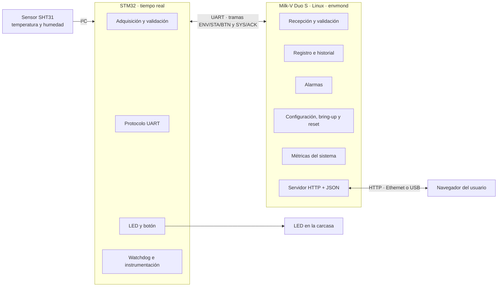
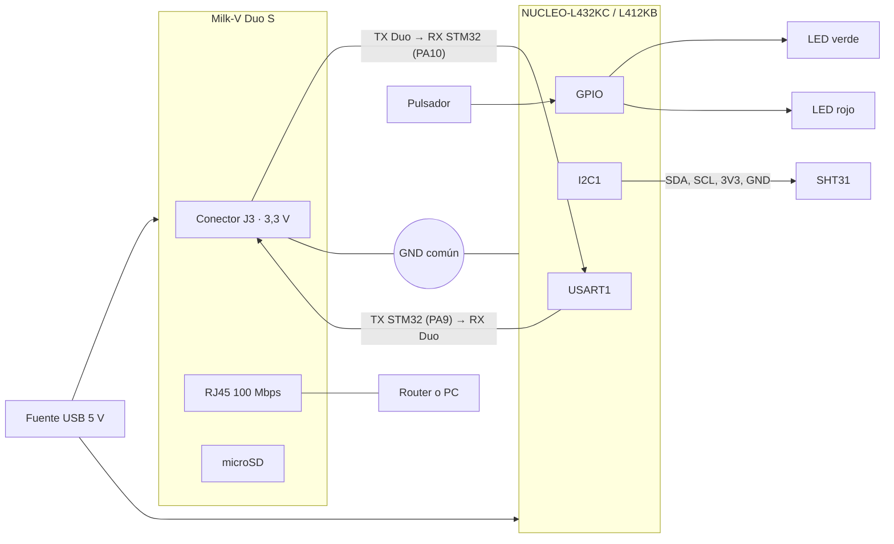
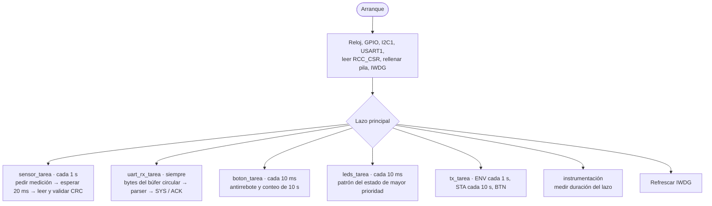
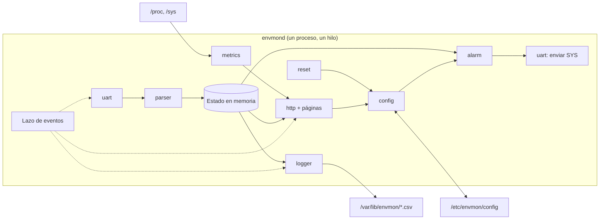
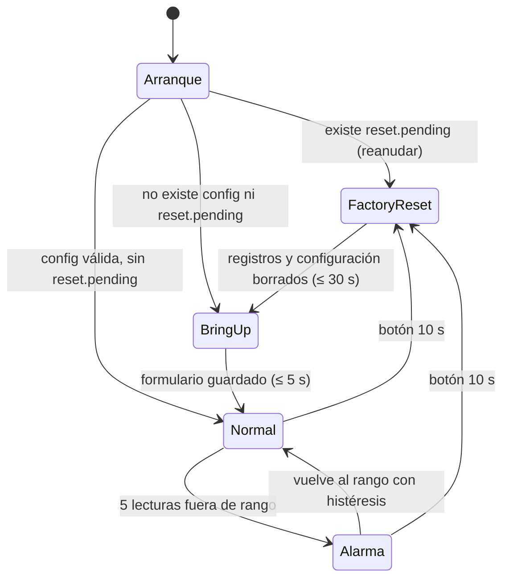
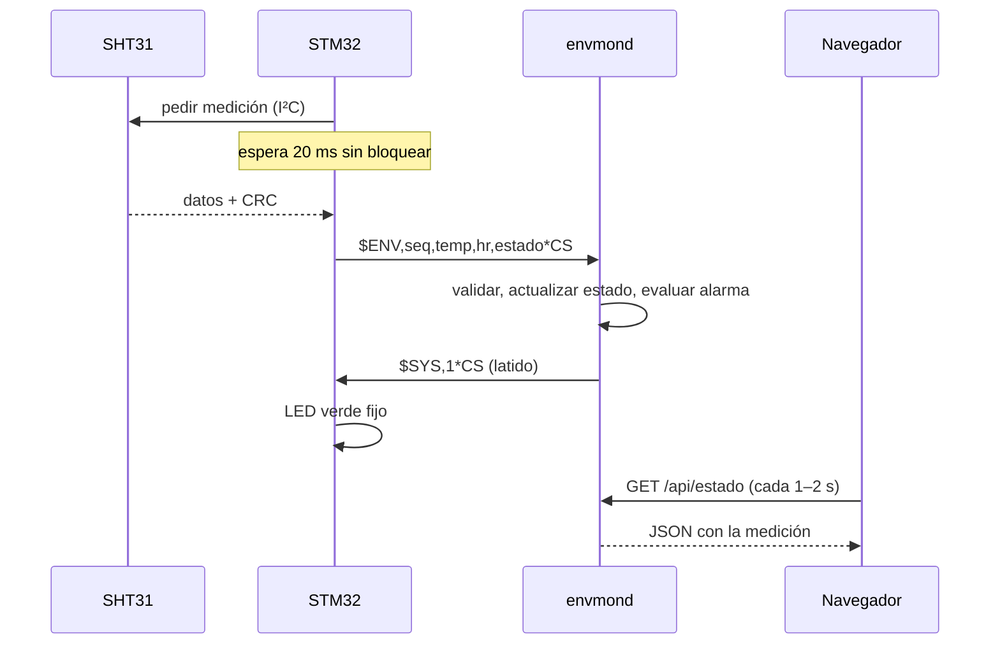
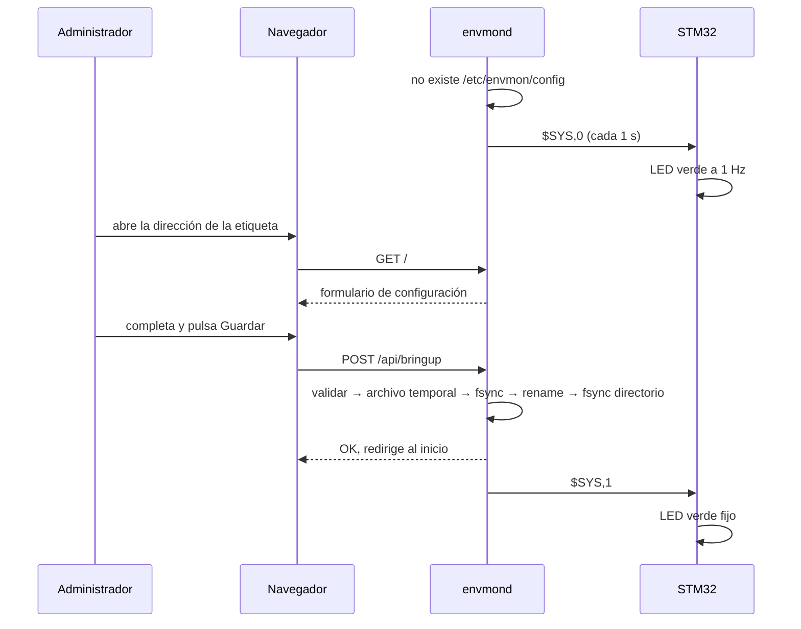
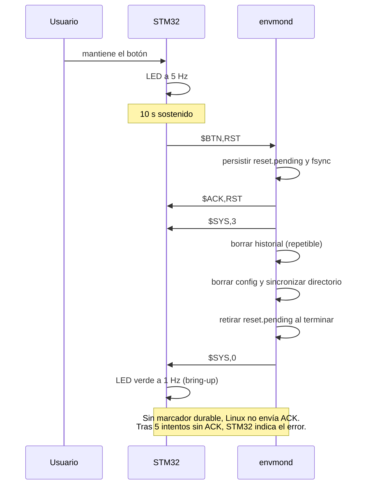
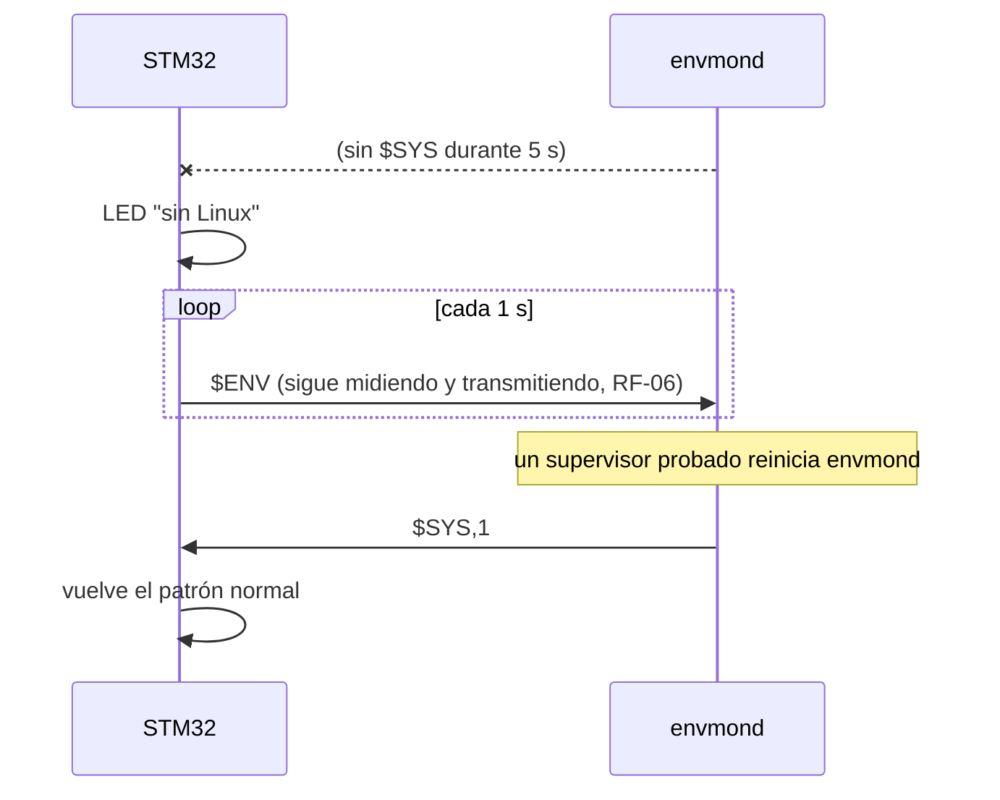

# Arquitectura de la solución

Versión: 0.2 (borrador para revisión: hardware, imagen Linux y servidor HTTP aún sin validar)

Este documento describe **cómo** se construye el sistema. El **qué** está en [requerimientos.md](requerimientos.md) y el **para qué** en [descripcion-sistema.md](descripcion-sistema.md). Los contratos entre partes están en [protocolo-uart.md](protocolo-uart.md) e [interfaces.md](interfaces.md).

Los diagramas están en Mermaid y GitHub los muestra directamente.

> **Aplicación:** supervisión de un gabinete documental pequeño para conservación preventiva del papel. El perfil sugerido de **18–22 °C y 35–50 % HR** es editable; ver [criterios-conservacion.md](criterios-conservacion.md). Sin control climático ni validación física todavía.

## 1. Vistas

| Vista | Pregunta que responde | Sección |
|---|---|---|
| Lógica | ¿Qué bloques hay y qué hace cada uno? | §2 |
| Física | ¿Qué hardware hay y cómo se conecta? | §3 |
| Firmware | ¿Cómo está organizado el programa del STM32? | §4 |
| Software Linux | ¿Qué procesos, módulos y archivos hay en la Milk-V? | §5 |
| Comportamiento | ¿Cómo interactúan las partes en el tiempo? | §6 |
| Decisiones | ¿Por qué se eligió cada cosa? | §7 |

## 2. Vista lógica

**Regla de reparto.** Lo que depende del tiempo real o del hardware vive en el STM32 y sigue funcionando sin Linux (RF-06). Lo que necesita almacenamiento, red o interfaz gráfica vive en Linux. El STM32 no guarda configuración: toda la configuración está en Linux, así el factory reset solo tiene que borrar archivos en un lugar.

| Bloque | Dueño | Requerimientos |
|---|---|---|
| Adquisición y validación | Andrew | RF-01 a RF-05 |
| UART en STM32 y enlace físico | Andrew | RF-10, RF-11 |
| UART en Linux, parser, secuencia y latido `SYS` | Mateo | RF-10 a RF-13 |
| LED, botón, watchdog, instrumentación del STM32 | Andrew | RF-05, RF-07, RF-31, RF-50, RF-51, RF-54 |
| Servicio Linux, historial, configuración, HTTP/API y supervisión | Mateo | RF-20 a RF-25, RF-40 a RF-44 |
| Páginas de bring-up y ajustes | Mateo | RF-32, RF-41, RF-42 |
| Dashboard, historial y página de diagnóstico | Juan Fernando | RF-30, RF-60 a RF-64 |
| Pulsador físico, solicitud de reset y LED | Andrew | RF-31, RF-50, RF-51, RF-54 |
| Alarmas y recuperación del factory reset en Linux | Mateo | RF-23, RF-24, RF-52, RF-53 |
| Métricas del sistema y página de diagnóstico | Juan Fernando | RF-60 a RF-64 |

## 3. Vista física

### Asignación de pines (propuesta, se confirma en PI-01 y PI-02)

| Señal | NUCLEO-L432KC / L412KB | Milk-V Duo S | Nota |
|---|---|---|---|
| UART STM32 TX → Linux RX | PA9 (D1), USART1 | Candidata UART2 RX, B12/J3 pin 13 | No usar UART0 del J3 (pines 8 y 10): es la consola de Linux |
| UART Linux TX → STM32 RX | PA10 (D0), USART1 | Candidata UART2 TX, B11/J3 pin 11 | La USART2 del NUCLEO va al ST-LINK (puerto virtual) y queda para depuración |
| GND | GND | J3 pin 6 | Revisar la versión de la placa: el pin 9 es GPIO en v1.1 y GND desde v1.2 |
| I²C SDA | PB7 (D4), I2C1 | — | Pull-ups en el módulo del sensor |
| I²C SCL | PB6 (D5), I2C1 | — | |
| LED verde | PB3/D13 (LD3 de placa) | — | Resistencia en serie según el LED |
| LED rojo | PB0/D3 (LED externo) | — | |
| Botón de reset | PA12/D2 (pulsador externo con pull-up) | — | Activo en bajo, antirrebote por software |

Los pines del NUCLEO se contrastaron con el manual UM1956; comprobar puentes de soldadura/pines I²C (ver firmware/README.md) y continuidad antes de cablear. El pulsador NRST no es el pulsador de factory reset. La selección UART2 de la Milk-V es solo candidata hasta comprobar DT, pinmux y loopback. Las alimentaciones de las dos placas **no** se unen; solo se comparte GND.

## 4. Firmware del STM32

Lazo principal cooperativo (*superloop*) sin RTOS, con una base de tiempo de 1 ms (SysTick). Cada tarea revisa si le toca y retorna; las operaciones HAL de I²C y UART tienen tiempos de espera acotados. No se espera indefinidamente a Linux ni a la conversión del sensor.

| Decisión | Motivo |
|---|---|
| Recepción UART por interrupción a un búfer circular | No se pierden bytes de `SYS` aunque el lazo esté ocupado leyendo el sensor |
| Transmisión no bloqueante (interrupción o DMA) | Una trama de 33 bytes tarda ~2,9 ms a 115200 baudios; no debe frenar el lazo |
| Medición del SHT31 en dos pasos (pedir, leer 20 ms después) | La conversión tarda hasta ~15 ms; esperar con `HAL_Delay` bloquearía todo |
| IWDG de ~2 s refrescado solo en el lazo | Si cualquier tarea se cuelga, el lazo deja de refrescar y el STM32 se reinicia (RF-05) |
| Lógica pura separada de la HAL (`sht31`, `protocol`, `button`, `leds`) | Se prueba en el PC con Unity (PU-01, PU-02, PU-03, PU-10) |

## 5. Software en la Milk-V

### Procesos

Un único proceso propio, `envmond`, escrito en C, con servidor HTTP embebido es el diseño propuesto. **La biblioteca HTTP aún no está seleccionada**: debe ser compatible con la licencia GPL-3.0 del repositorio, compilar para la Milk-V y cumplir los límites de recursos. Mongoose no queda aprobado automáticamente; si ninguna biblioteca resulta viable, se reconsiderará un servidor ligero separado.

`envmond` tiene **un solo hilo** con un lazo de eventos: en cada vuelta atiende la UART (lectura no bloqueante), las conexiones HTTP y los temporizadores de 1 s (enviar `SYS`, publicar el estado) y del intervalo de registro. Un solo hilo evita candados y carreras entre la recepción, la web y el registro.

| Módulo | Dueño | Prueba unitaria |
|---|---|---|
| `uart`, `parser`, `alarm`, `reset` | Mateo | PU-04, PU-05, PU-06, PU-12, PU-13 |
| `config`, `logger`, `http`/API y páginas de bring-up/ajustes | Mateo | PU-07, PU-09, PU-11, PU-14, PU-15 |
| `metrics` y páginas de consulta y diagnóstico | Juan Fernando | PU-08, PI-08, PI-10 |

### Archivos en la Milk-V

| Ruta | Contenido | Dónde vive | Lo borra el factory reset |
|---|---|---|---|
| `/usr/bin/envmond` | Binario del servicio | microSD | No |
| `/usr/share/envmon/www/` | Páginas web estáticas | microSD | No |
| Script de inicio + mecanismo de supervisión compatible con `init` | Arranque automático y recuperación tras caída de `envmond` (RF-20) | microSD | No |
| `/etc/envmon/config` | Configuración del bring-up | microSD | Sí, durante el reset |
| `/etc/envmon/reset.pending` | Marcador durable de restablecimiento pendiente | microSD | Se elimina al finalizar el reset |
| `/var/lib/envmon/AAAA-MM-DD.csv` | Historial agregado | microSD | Sí |

La imagen oficial de la Duo S está basada en Buildroot y puede usar `init` de BusyBox en lugar de systemd. En el montaje anterior uCuPViewer, la placa real usaba Debian forky/sid, kernel 5.10.4-20240527-2+, arquitectura riscv64 y systemd; [evidencia del 5 de noviembre](https://github.com/anhenaobe/uCuPViewer/blob/737c89fece8e1244e8d76db4acdbf6a78dbf1f58/docs/debug/milkv_usb_diagnostico.md). Confirmar que la imagen no cambió antes de elegir el supervisor. **Un script de arranque no reinicia por sí solo un proceso tras `kill -9`**: hay que comprobar en PI-01/PI-07 `respawn` de `init` u otro supervisor compatible con la imagen. El estado actual vive en memoria de `envmond` y se expone directamente por HTTP/JSON; no se duplica cada segundo en un archivo de `/run`.

### Compilación

| Objetivo | Comando previsto | Para qué |
|---|---|---|
| Duo S (RISC-V) | `make` con el toolchain del SDK de Milk-V | Binario que se copia a la placa |
| Host (x86) | `make host` | Correr el servicio en el PC con un puerto serie virtual (`socat`) y Valgrind |
| Pruebas | `make test` | Pruebas unitarias (Unity o CMocka) |
| Firmware | PlatformIO o STM32CubeIDE + `arm-none-eabi-size` | Binario del STM32 y verificación de tamaño (RNF-13) |

## 6. Comportamiento

### 6.1 Estados del sistema

### 6.2 Funcionamiento normal (cada segundo)

### 6.3 Bring-up

### 6.4 Factory reset

**Recuperación tras apagado:** si existe `/etc/envmon/reset.pending`, `envmond` completa el borrado idempotente antes de habilitar la interfaz web. Si el apagado ocurrió antes de que el marcador fuera durable, permanece la configuración anterior. La recuperación debe validarse con la microSD y la imagen Linux utilizadas; no protege frente a daños físicos o corrupción del sistema de archivos.

### 6.5 Linux no responde

## 7. Decisiones de arquitectura

| # | Decisión | Alternativas descartadas | Motivo | Estado |
|---|---|---|---|---|
| D1 | UART entre placas | SPI, I²C | En el reto anterior el SPI de la Milk-V no estuvo disponible; la UART se depura con cualquier terminal y basta para 1 trama/s | Decidida |
| D2 | Protocolo de texto con checksum XOR | Binario con CRC | Legible en la terminal; 33 bytes/s están muy lejos del límite de 115200 baudios | Decidida |
| D3 | C en el firmware y en Linux | Python, Node | Recomendación del curso: compilado, nativo y con menos recursos (RNF-01, RNF-02) | Decidida |
| D4 | Un proceso de un solo hilo con servidor HTTP embebible y licencia compatible | Servicio HTTP separado y CGI; varios hilos | Menor complejidad potencial; pendiente comprobar licencia, compilación RISC-V y memoria | Propuesta, biblioteca por decidir |
| D5 | Botón de reset en el STM32 | Botón en un GPIO de Linux; opción en la web | Funciona aunque la web no responda; evita resets accidentales desde la red | Decidida |
| D6 | Configuración solo en Linux y reset recuperable mediante `reset.pending` | Configuración también en STM32; borrado sin marcador | Permite reanudar el reset tras corte de alimentación, sujeto a ensayos reales (RF-53) | Propuesta, pendiente validar |
| D7 | Estado en RAM dentro de `envmond` e historial persistente por intervalo | Escribir cada medición en microSD o duplicar estado en archivo JSON | Menos E/S y menos componentes que mantener (RNF-08) | Propuesta |
| D8 | Acceso al bring-up por dirección fija | DHCP + buscar la IP en el router | Un usuario no experto no sabe encontrar la IP (RF-46) | Propuesta (red USB o Ethernet directa, se decide en PI-01) |
